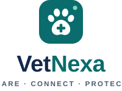

# VetNexa

**AI-assisted pet healthcare and animal welfare platform.**

VetNexa connects pet owners, veterinarians, veterinary clinics, animal rescuers and adopters in one place. Owners keep their pets' health records organised, find nearby clinics, book consultations and get an early, AI-supported indication of whether a wound needs veterinary attention. Rescuers and adopters use the same platform to give animals in need a new home.

> **AI safety notice:** VetNexa's wound assessment is a decision-support prototype. It does not diagnose and is not a substitute for examination by a qualified veterinarian.

## Main modules

- Pet owner accounts and pet profiles
- Health records (vaccinations, treatments, medical history)
- AI wound assessment for dogs and cats
- Veterinary portal and consultations
- Clinic discovery with reviews and ratings
- Rescue reporting and adoption
- AI pet-care chatbot
- Admin dashboard

## Technology

| Area | Technology |
| --- | --- |
| Front end | React, TypeScript, Vite |
| Back end | Node.js, Express, TypeScript |
| Database | MySQL with Prisma ORM |
| AI | Python, PyTorch, OpenCV |
| Testing | Vitest, Supertest, pytest |
| Quality | ESLint, Prettier |
| DevOps | Docker, Docker Compose, GitHub Actions |

## Documentation

- [Architecture](docs/architecture.md)
- [Project plan](docs/project-plan.md)
- [Brand guidelines](docs/brand-guidelines.md)

## Project owner

**Pradeesha Baskaran** – developer
Contact: 0785503592
