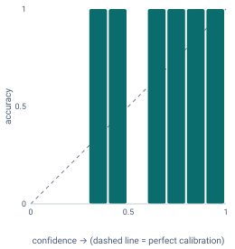
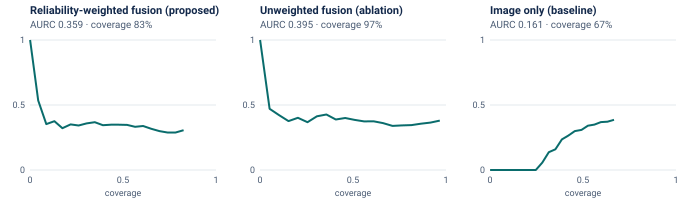

# AI Evaluation Report

**VetNexa: A Safety-Aware Multimodal Deep Learning Framework for Veterinary Wound Assessment
Using Reliability-Weighted Evidence Fusion and Uncertainty-Aware Triage**

Pradeesha Baskaran · final evaluation, 21 November 2026

> **Scope of these results.** No dataset yet pairs real dog and cat wound photos with owners'
> answers to symptom questions. Every number in this report comes from the **demonstration
> model**, trained on synthetic drawings, and from **simulated** owner answers. The results
> show whether the _method_ behaves as designed; they are **not** a measure of how well
> VetNexa assesses real wounds. Section 8 sets out how the same evaluation will be repeated on
> real, veterinarian-labelled cases.

## 1. Aim and questions

The project poster proposes that a wound check should not trust a photo alone. It should
combine the photo with symptom answers, weight each by how reliable it is, and refuse to answer
when the evidence is too weak. The evaluation asks:

1. **Safety:** does reliability-weighted fusion find more urgent cases than a photo-only model
   or an unweighted combination? (primary measure: urgent-case sensitivity)
2. **Robustness:** when the photo is poor or unfamiliar, or the answers are missing, does it
   avoid telling owners that a wound needing a vet is routine?
3. **Honesty:** are confidence values calibrated, and are unfamiliar images recognised
   (out-of-distribution detection)?
4. **Cost:** how often does it abstain ("unable to assess safely") or send owners to a vet
   unnecessarily?

## 2. System evaluated

| Stage             | Implementation                                                                                                                                                         |
| ----------------- | ---------------------------------------------------------------------------------------------------------------------------------------------------------------------- |
| Input checks      | OpenCV quality score (sharpness, exposure, size); 8 red flags; questionnaire completeness                                                                              |
| Photo model       | EfficientNet-B0 (ImageNet weights) with a five-class head: abrasion, laceration, puncture, abscess or infection, healthy skin                                          |
| Calibration       | Temperature scaling fitted on the validation set, never below 1 (confidence is only ever softened)                                                                     |
| Unfamiliar images | Energy score and Mahalanobis distance (Ledoit-Wolf covariance), thresholds at the 97.5th percentile of validation photos                                               |
| Symptom evidence  | 7 questions and 23 documented rules combined with a noisy-OR into a risk and a level                                                                                   |
| Fusion            | Photo reliability = quality × familiarity × (0.5 + 0.5 × certainty); answer reliability = completeness; risk = Σ reliability × risk / Σ reliability                    |
| Triage            | Four outcomes (routine, consultation, urgent, unable); safety overrides for red flags, reliable inputs and always-refer wound types; abstention below 0.35 reliability |

Model version: `wound-efficientnetb0-20261121-0936` (demonstration). Baseline backbone:
ResNet-18 trained the same way. Full method: [model card](ai-model.md).

## 3. Data

| Set                 | Content                                                                                                                                                     |
| ------------------- | ----------------------------------------------------------------------------------------------------------------------------------------------------------- |
| Training data       | Synthetic drawings of the five classes (`vetnexa_ai.synthetic`), group-aware split                                                                          |
| Test photos         | **44** held-out drawings: 8 abrasion, 8 laceration, 12 puncture, 8 abscess or infection, 8 healthy skin; never used for training, calibration or thresholds |
| Unfamiliar images   | 60 generated non-wound images (patterns, gradients, noise, shapes)                                                                                          |
| Owner answers       | Simulated from each photo's true class with a fixed, documented protocol                                                                                    |
| Real data collected | 62 photos of dog skin (healthy skin and three skin diseases, Mendeley, CC BY 4.0); no wound photos                                                          |
| Real data requested | PetWound (290 wound photos of 208 dogs and 82 cats) and clinical photos from a partner clinic                                                               |

The real skin photos are not used in this evaluation because they do not contain wounds and
are too few to train on. The data policy and its evidence are in
[services/ai/datasets/README.md](../services/ai/datasets/README.md).

## 4. Method

### 4.1 Photo model

`python -m vetnexa_ai.evaluate` on the 44 test photos: accuracy, balanced accuracy, macro-F1,
per-class precision and recall, confusion matrix, expected calibration error (ECE), coverage
and the **under-triage rate** (a moderate or severe wound shown as minor).

### 4.2 Triage

Every test photo was combined with every answer scenario, three times with different random
answers (seed 7):

| Factor  | Levels                                                                                                                                     |
| ------- | ------------------------------------------------------------------------------------------------------------------------------------------ |
| Photo   | _clean_; _degraded_ (Gaussian blur, 38 % darker); _unfamiliar_ (replaced by a non-wound image)                                             |
| Answers | _accurate_ (10 % random); _noisy_ (40 % random); _sparse_ (70 % "not sure"); _none_                                                        |
| Method  | **image only** (baseline); **unweighted fusion** (ablation: equal weights); **reliability-weighted fusion** (proposed, as used in the app) |

That gives 1 320 cases per method. True urgency: healthy skin and grazes → routine; cuts and
punctures → consultation; abscess or infection → urgent.

| Measure                     | Definition                                                                             |
| --------------------------- | -------------------------------------------------------------------------------------- |
| Urgent sensitivity          | Urgent cases shown as _urgent_ (primary measure)                                       |
| Urgent sent to a vet        | Urgent cases shown as urgent, consultation or unable (all tell the owner to see a vet) |
| Needed a vet, shown routine | The most dangerous error                                                               |
| Under- and over-triage      | Outcome less or more urgent than the truth, on assessed cases                          |
| Macro-F1, accuracy          | Over the three urgency levels, on assessed cases                                       |
| Coverage, AURC              | Share of cases assessed; area under the risk–coverage curve                            |

## 5. Results

### 5.1 Photo model

| Measure                      | EfficientNet-B0         | ResNet-18 (baseline) |
| ---------------------------- | ----------------------- | -------------------- |
| Accuracy / balanced accuracy | 100 % / 100 %           | 100 %                |
| Macro-F1                     | 1.000                   | 1.000                |
| ECE after calibration        | 0.167                   | 0.141                |
| Coverage (not "uncertain")   | 81.8 %                  | –                    |
| Accuracy when answered       | 100 %                   | –                    |
| Under-triage                 | 0 % of 28 serious cases | –                    |

Every class has precision and recall 1.00. The synthetic drawings are too easy to separate,
so this test cannot distinguish the two backbones or say anything about real photos.

### 5.2 Triage: overall

| Method                              | Urgent sensitivity | Urgent sent to a vet | Needed a vet, shown routine | Under-triage | Over-triage | Macro-F1  | Accuracy   | Coverage | AURC  |
| ----------------------------------- | ------------------ | -------------------- | --------------------------- | ------------ | ----------- | --------- | ---------- | -------- | ----- |
| **Reliability-weighted (proposed)** | **80.0 %**         | 99.2 %               | **2.7 %**                   | **3.2 %**    | 27.4 %      | **0.686** | **69.4 %** | 82.6 %   | 0.359 |
| Unweighted fusion (ablation)        | 68.3 %             | 93.8 %               | 9.5 %                       | 10.4 %       | 27.6 %      | 0.612     | 62.0 %     | 96.7 %   | 0.395 |
| Image only (baseline)               | 41.7 %             | 100 %                | 1.2 %                       | 8.0 %        | 30.7 %      | 0.564     | 61.4 %     | 66.7 %   | 0.161 |

### 5.3 Triage: by scenario

Urgent sensitivity (coverage in brackets):

| Photo / answers     | Reliability-weighted | Unweighted     | Image only     |
| ------------------- | -------------------- | -------------- | -------------- |
| clean / accurate    | 100 % (100 %)        | 100 % (100 %)  | 100 % (100 %)  |
| clean / sparse      | 95.8 % (92.4 %)      | 45.8 % (100 %) | 100 % (100 %)  |
| clean / none        | 100 % (79.5 %)       | 100 % (100 %)  | 100 % (100 %)  |
| degraded / noisy    | 95.8 % (100 %)       | 95.8 % (100 %) | 0 % (0 %)      |
| degraded / sparse   | 25.0 % (32.6 %)      | 25.0 % (100 %) | 0 % (0 %)      |
| degraded / none     | 0 % (0 %)            | 0 % (0 %)      | 0 % (0 %)      |
| unfamiliar / noisy  | 95.8 % (100 %)       | 70.8 % (100 %) | 25.0 % (100 %) |
| unfamiliar / sparse | 45.8 % (66.7 %)      | 8.3 % (100 %)  | 25.0 % (100 %) |
| unfamiliar / none   | 25.0 % (22.7 %)      | 25.0 % (100 %) | 25.0 % (100 %) |

Share of cases that needed a vet but were shown as routine:

| Photo / answers     | Reliability-weighted | Unweighted | Image only |
| ------------------- | -------------------- | ---------- | ---------- |
| degraded / sparse   | **4.8 %**            | 58.3 %     | 0 %\*      |
| unfamiliar / sparse | **8.3 %**            | 26.2 %     | 3.6 %      |
| unfamiliar / none   | **0 %**              | 3.6 %      | 3.6 %      |
| clean (any answers) | 0 %                  | 0 %        | 0 %        |

\* The image-only method cannot assess degraded photos at all, so it never shows them as anything.

### 5.4 Unfamiliar images and calibration

| Measure                                          | Value     |
| ------------------------------------------------ | --------- |
| AUROC, familiar vs unfamiliar                    | **0.939** |
| False-positive rate at 95 % true-positive rate   | 48.3 %    |
| Unfamiliar images flagged at the app's threshold | 71.7 %    |
| Familiar test photos wrongly flagged             | 11.4 %    |





## 6. Discussion

**Question 1, safety.** Reliability weighting found the most urgent cases: 80.0 % against
68.3 % (unweighted) and 41.7 % (image only), and had the lowest under-triage (3.2 %) and the
highest macro-F1 (0.686). Almost every urgent case (99.2 %) was sent to a veterinarian in some
form. This supports the poster's central claim on synthetic data.

**Question 2, robustness.** The difference is clearest when the evidence is weak. With a
degraded photo and mostly "not sure" answers, unweighted fusion told owners that 58.3 % of
cases needing a vet were routine; reliability weighting did so for 4.8 %. With a clean photo
and sparse answers, unweighted fusion let the vague answers dilute a clear photo (urgent
sensitivity 45.8 %), while reliability weighting kept 95.8 %. Down-weighting unreliable inputs
works as intended.

**Question 3, honesty.** The unfamiliar-image detector separates the two groups well
(AUROC 0.94) but not cleanly: at the app's threshold it catches 72 % of unfamiliar images and
wrongly flags 11 % of real test photos. Both photo models are under-confident on this easy task
(all reliability-diagram bars above the diagonal); because the temperature is never below 1, the
app never overstates confidence.

**Question 4, cost.** Safety is paid for with abstention and caution. Reliability weighting
answered 82.6 % of cases; the rest were "unable to assess safely", mostly where there was
neither a usable photo nor enough answers. Each abstention still tells the owner to see a vet,
so it is a safe failure, but a frequent one. Over-triage is high for every method (27–31 %),
because the symptom rules and the always-refer rules for cuts and punctures lean towards a
consultation. A veterinarian should review those weights.

**AURC.** The image-only method has the best AURC (0.161) only because it answers just the
clean photos, on which it is almost always right; its coverage (66.7 %) and urgent sensitivity
(41.7 %) show why AURC must be read together with coverage.

## 7. Threats to validity

- Synthetic photos and simulated answers. Real photos (fur, lighting, coat colour, phone
  cameras) and real owners' answers will be noisier and correlated in ways the simulation does
  not capture.
- Small test set: 44 photos; each scenario row is based on 44–132 cases, so differences of a
  few percentage points are not meaningful.
- The mapping from wound type to urgency is a simplification; real urgency depends on the
  individual animal.
- Rule weights, class risks and thresholds are the developer's drafts and have not been
  validated by a veterinarian.
- The demonstration model reaches 100 % on drawings, so the evaluation cannot show how the
  fusion behaves when the photo model is often wrong, which it will be on real photos.

## 8. Conclusions and next steps

On synthetic data, reliability-weighted evidence fusion behaves as the poster proposed:

- It found more urgent cases than either alternative.
- It was much harder to mislead with poor photos or vague answers.
- When the evidence was too weak, it said so instead of guessing.

The price is more abstentions and frequent caution.

None of this shows real-world performance. Before any clinical use:

1. **Real data.** Obtain PetWound and partner-clinic photos with ethics approval, and have
   veterinarians label the wound type and urgency.
2. **Real answers.** Collect owners' questionnaire answers for the same cases.
3. **Repeat this evaluation** unchanged (`vetnexa_ai.evaluate_triage`) on held-out real cases,
   reporting urgent sensitivity with confidence intervals, and compare EfficientNet-B0 and
   ResNet-18 again.
4. **Clinical review** of the rule weights, class risks and the 0.35 abstention threshold, aiming
   to lower over-triage without losing urgent sensitivity.
5. **Prospective study** comparing VetNexa's outcome with a veterinarian's on new cases, and
   monitoring under-triage in use.

## 9. Reproducing the results

```bash
cd services/ai
python -m vetnexa_ai.synthetic --out data/synthetic --per-class 60
python -m vetnexa_ai.train --data-dir data/synthetic --output-dir models --epochs 6 --demo
python -m vetnexa_ai.train --data-dir data/synthetic --output-dir models/baseline-resnet18 \
  --arch resnet18 --epochs 6 --demo
python -m vetnexa_ai.evaluate --model models/wound-classifier.pt
python -m vetnexa_ai.evaluate_triage --model models/wound-classifier.pt \
  --baseline-model models/baseline-resnet18/wound-classifier.pt --draws 3 --seed 7
```

Outputs: `reports/evaluation.md`, `reports/triage-evaluation.md` and `.json`, and the two SVG
charts. The scenario tables and further interpretation are in [evaluation.md](evaluation.md).
