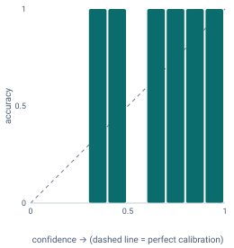
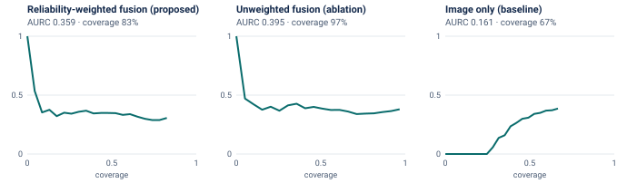

# Triage Evaluation

This is the evaluation planned in the project poster (section 10): urgent-case sensitivity as
the primary measure, macro-F1 and per-class recall, calibration (ECE), selective risk and
coverage, out-of-distribution (OOD) detection, and a comparison of the proposed
reliability-weighted fusion with an image-only baseline and an unweighted ablation.

> **Read this first.** No dataset yet pairs real dog and cat wound photos with owners' answers.
> The photo model here is the **demonstration model** trained on synthetic drawings, and the
> owners' answers are **simulated** from each photo's true wound type with a fixed, documented
> protocol. These results therefore show whether the _method_ behaves as designed. They are not
> a measure of clinical performance, and they must be repeated on real, veterinarian-labelled
> cases (PetWound or partner-clinic data) before any claim about real-world use.

Reproduce with:

```bash
cd services/ai
python -m vetnexa_ai.train --data-dir data/synthetic --output-dir models --epochs 6 --demo
python -m vetnexa_ai.train --data-dir data/synthetic --output-dir models/baseline-resnet18 \
  --arch resnet18 --epochs 6 --demo
python -m vetnexa_ai.evaluate_triage --model models/wound-classifier.pt \
  --baseline-model models/baseline-resnet18/wound-classifier.pt --draws 3 --seed 7
```

## Design

| Item             | Setting                                                                                                                                                        |
| ---------------- | -------------------------------------------------------------------------------------------------------------------------------------------------------------- |
| Test photos      | 44 held-out photos (group-aware split; never used for training, calibration or OOD thresholds)                                                                 |
| Photo scenarios  | _clean_; _degraded_ (Gaussian blur and 38 % darker); _unfamiliar_ (the photo is swapped for a generated non-wound image)                                       |
| Answer scenarios | _accurate_ (10 % random answers); _noisy_ (40 % random); _sparse_ (70 % "not sure"); _none_ (no questionnaire)                                                 |
| Cases            | 1 320 per method (photo × answer scenario × 3 answer draws)                                                                                                    |
| Ground truth     | healthy skin, graze → routine; cut, puncture → consultation; abscess or infection → urgent                                                                     |
| Methods          | **image only** (baseline) · **unweighted fusion** (ablation: photo and answers count equally) · **reliability-weighted fusion** (proposed, as used in the app) |
| OOD test         | the 44 familiar test photos against 60 generated unfamiliar images (patterns, gradients, noise, shapes)                                                        |

## Results

### Overall

| Method                                 | Urgent sensitivity | Urgent sent to a vet | Needed a vet, shown routine | Under-triage | Over-triage | Macro-F1  | Coverage | AURC  |
| -------------------------------------- | ------------------ | -------------------- | --------------------------- | ------------ | ----------- | --------- | -------- | ----- |
| Reliability-weighted fusion (proposed) | **80.0 %**         | 99.2 %               | 2.7 %                       | **3.2 %**    | 27.4 %      | **0.686** | 82.6 %   | 0.359 |
| Unweighted fusion (ablation)           | 68.3 %             | 93.8 %               | 9.5 %                       | 10.4 %       | 27.6 %      | 0.612     | 96.7 %   | 0.395 |
| Image only (baseline)                  | 41.7 %             | 100 %                | 1.2 %                       | 8.0 %        | 30.7 %      | 0.564     | 66.7 %   | 0.161 |

_Urgent sensitivity_: urgent cases shown as urgent. _Urgent sent to a vet_: urgent cases shown as
urgent, consultation or "unable to assess" (all of which tell the owner to see a vet). _Needed a
vet, shown routine_: the most dangerous error. _Under-/over-triage_ and _macro-F1_ are measured on
assessed cases; _coverage_ is the share not answered "unable to assess safely".

### Where the methods differ

Share of cases that needed a veterinarian but were shown as routine care:

| Photo / answers     | Reliability-weighted | Unweighted | Image only |
| ------------------- | -------------------- | ---------- | ---------- |
| degraded / sparse   | **4.8 %**            | 58.3 %     | 0 %\*      |
| unfamiliar / sparse | **8.3 %**            | 26.2 %     | 3.6 %      |
| unfamiliar / none   | **0 %**              | 3.6 %      | 3.6 %      |
| degraded / noisy    | 7.1 %                | 7.1 %      | 0 %\*      |
| clean (any answers) | 0 %                  | 0 %        | 0 %        |

\* Degraded photos fail the quality gate, so the image-only method cannot assess them at all (0 %
coverage); it never shows them as routine because it never shows them as anything.

### Out-of-distribution detection

| Measure                                          | Value     |
| ------------------------------------------------ | --------- |
| AUROC (familiar vs unfamiliar)                   | **0.939** |
| FPR at 95 % TPR                                  | 48.3 %    |
| Unfamiliar images flagged at the app's threshold | 71.7 %    |
| Familiar test photos wrongly flagged             | 11.4 %    |

### Photo model and calibration

| Model                      | Accuracy | Macro-F1 | ECE   |
| -------------------------- | -------- | -------- | ----- |
| EfficientNet-B0 (proposed) | 100 %    | 1.000    | 0.167 |
| ResNet-18 (baseline)       | 100 %    | 1.000    | 0.141 |





## Interpretation

1. **Reliability weighting finds more urgent cases.** Urgent-case sensitivity rose from 41.7 %
   (image only) and 68.3 % (unweighted) to 80.0 %, and under-triage fell from 8.0 % and 10.4 % to
   3.2 %. Macro-F1 was also highest (0.686).
2. **It avoids being misled by poor evidence.** When the photo was degraded or unfamiliar and most
   answers were "not sure", unweighted fusion showed 58.3 % and 26.2 % of cases that needed a vet
   as routine care; reliability weighting showed 4.8 % and 8.3 %. Down-weighting unreliable inputs
   is exactly what the poster proposed.
3. **The cost is abstention.** Reliability weighting answered 82.6 % of cases and said "unable to
   assess safely" for the rest, mostly when there was neither a usable photo nor enough answers.
   Every abstention tells the owner to see a vet, so it is a safe failure, but a frequent one.
4. **Over-triage is high for every method (27–31 %).** The symptom rules send grazes with an
   accident and red skin to a consultation, and the photo safety rules lean the same way. This is
   deliberate caution, but it would mean many unnecessary visits; a veterinarian should review the
   rule weights.
5. **AURC is not a fair comparison here.** The image-only method answers only the clean photos,
   on which it is almost always right, so its curve looks best (0.161). Its low coverage and poor
   urgent sensitivity show why AURC must be read together with coverage. For the fusion methods,
   the most reliable cases (complete answers) are not always the most correct ones, because the
   simulated graze answers point to a consultation; this is why their curves start high.
6. **OOD detection separates the two groups well (AUROC 0.94) but not cleanly.** Half of the
   unfamiliar images would pass at a threshold that keeps 95 % of familiar photos, and 11 % of
   familiar test photos were flagged. Better thresholds need real photos and real non-wound images.
7. **Calibration.** Both photo models are under-confident (all bars above the diagonal): on this
   easy synthetic task they are right more often than they say. The temperature is never allowed
   below 1, so the app never overstates confidence; real data will show a more meaningful ECE.
8. **Backbones.** Both reach 100 % on synthetic drawings, so this test cannot tell EfficientNet-B0
   and ResNet-18 apart. The comparison must be repeated on real photos.

## Threats to validity

- Synthetic photos and simulated answers; real photos and answers will be noisier and correlated
  in ways the simulation does not capture.
- Small test set (44 photos); figures for individual scenarios are based on 44–132 cases.
- The ground-truth mapping from wound type to urgency is a simplification; real triage depends on
  the individual case.
- Rule weights, class risks and thresholds are developer drafts, not veterinary-validated.

Next step: run exactly this evaluation on veterinarian-labelled real cases.
