# VetNexa User Guide

How to use VetNexa, the healthcare and welfare platform for **dogs and cats**. This guide is
for pet owners, veterinarians, rescuers and administrators, and for anyone who needs help in an
emergency without an account.

> **Important.** VetNexa's wound check and pet-care assistant give general, cautious guidance.
> They do not diagnose and never replace a veterinarian. If your pet is in danger, contact a
> clinic straight away.

Screenshots were taken from the demonstration version with its sample data.

## Contents

1. [Emergency help (no account needed)](#1-emergency-help-no-account-needed)
2. [Creating an account and signing in](#2-creating-an-account-and-signing-in)
3. [Pet owners](#3-pet-owners)
4. [The wound check](#4-the-wound-check)
5. [Ask VetNexa, the pet-care assistant](#5-ask-vetnexa-the-pet-care-assistant)
6. [Finding a clinic](#6-finding-a-clinic)
7. [Rescue reports and adoption](#7-rescue-reports-and-adoption)
8. [Veterinarians](#8-veterinarians)
9. [Rescuers](#9-rescuers)
10. [Administrators](#10-administrators)
11. [Installing VetNexa on your phone](#11-installing-vetnexa-on-your-phone)
12. [Privacy and safety](#12-privacy-and-safety)
13. [Questions and answers](#13-questions-and-answers)

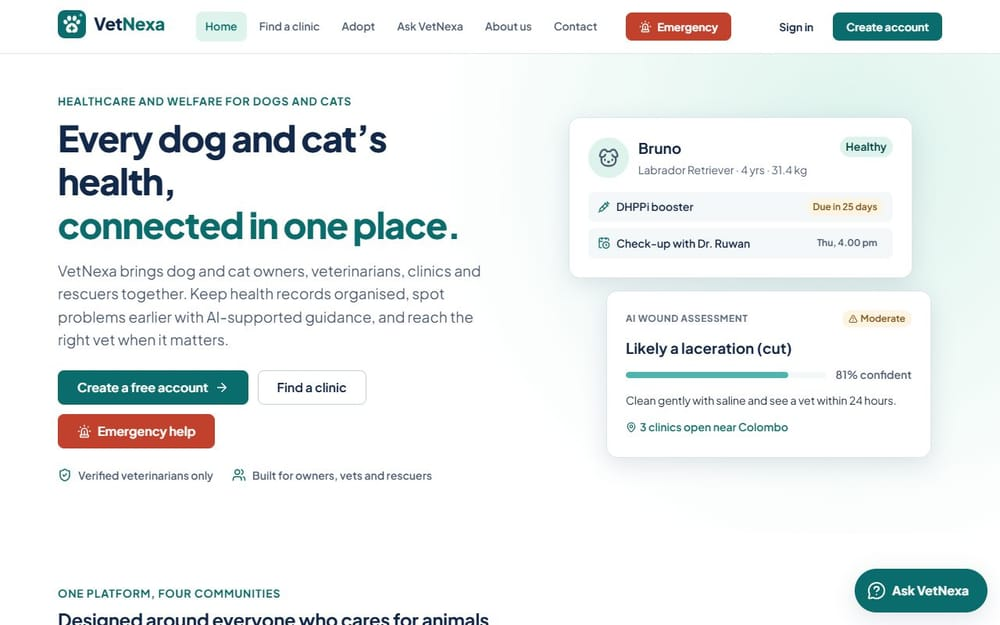

## 1. Emergency help (no account needed)

Press the red **Emergency** button at the top of any page (or **Emergency help** in the menu).
Everything on this page works without signing in.

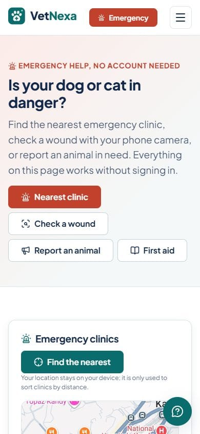

| Section                            | What it does                                                                                                                      |
| ---------------------------------- | --------------------------------------------------------------------------------------------------------------------------------- |
| **Emergency clinics**              | Emergency and 24-hour clinics. Press **Find the nearest** to sort them by distance; then **Call** or **Directions** with one tap. |
| **Check a wound with your camera** | A quick photo and symptom check (see [section 4](#4-the-wound-check)). The result is shown once and is **not saved**.             |
| **Report an animal in need**       | For injured or abandoned dogs and cats that are not yours. Registered rescuers nearby see the report and may call you.            |
| **First-aid guides**               | Short guides for wounds, poisoning, heatstroke, seizures, snake bites, breathing problems, bloat and more.                        |
| **First steps**                    | What to do in the first minutes: stay safe, press on bleeding, keep the animal calm, call ahead.                                  |

Your location is only used on your phone to sort clinics, and only after you press
**Find the nearest**.

### Without internet

After VetNexa has been opened once on your phone, the emergency page also works with no
connection:

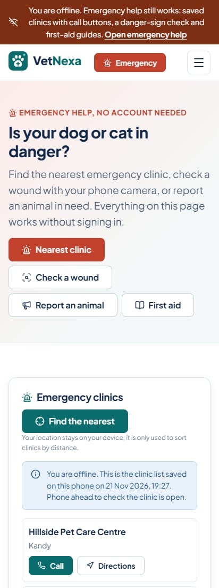

- **Saved clinic list** with its date. **Call** still works, because phone calls do not need
  data. Phone ahead to check the clinic is open.
- **Danger-sign check** instead of the photo check: tick any sign that applies. Any danger
  sign means _go to a veterinarian now_. With no signs, VetNexa still advises asking a vet,
  because a wound cannot be judged without a photo.
- **First-aid guides** work as normal.
- **Rescue reports** are kept on your phone and sent automatically when the connection returns.
  A message then shows the reference number.

A red banner at the top tells you when you are offline. Other pages show a short first-aid
page with a link to emergency help.

## 2. Creating an account and signing in

1. Press **Create account** at the top right.
2. Choose who you are: **pet owner**, **veterinarian** or **rescuer**.
3. Enter your name, email, mobile number and a password (at least 8 characters with an
   uppercase letter, a lowercase letter and a number).
4. **Veterinarians** also enter their licence number. An administrator checks it before you can
   see any patient information; until then your dashboard says your licence is being verified.

Sign in with **Sign in** at the top right. You stay signed in for 12 hours on that device. Use
the sign-out button at the bottom of the side menu when you share a computer.

After 10 unsuccessful sign-in attempts within 15 minutes, wait 15 minutes before trying again.

## 3. Pet owners

Your **dashboard** shows upcoming appointments, care that is due soon and your pets.

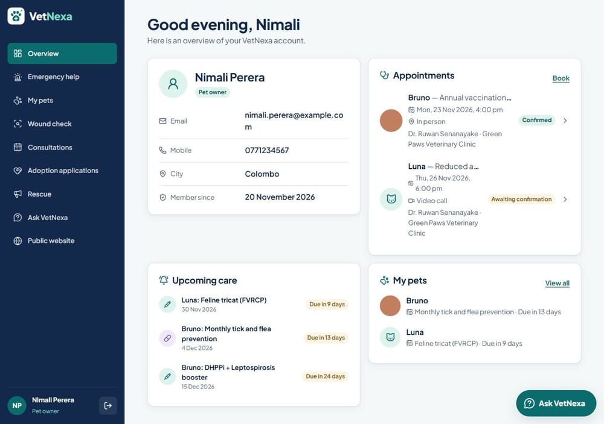

### Pet profiles

**My pets → Add a pet.** Enter the name, species (dog or cat), breed, sex, date of birth,
weight, colour, microchip number and notes such as allergies. Add a photo with
**Change photo**: phone photos are resized and their location data is removed.

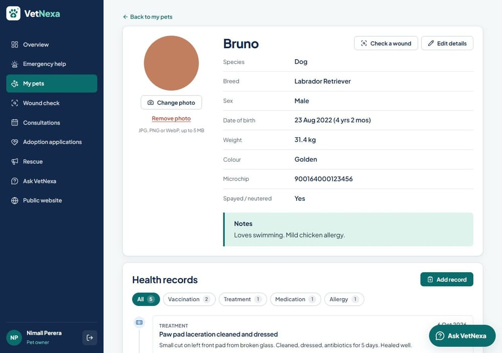

### Health records and reminders

On a pet's page, **Add record** keeps its history in one place:

| Type        | Examples                         |
| ----------- | -------------------------------- |
| Vaccination | Rabies, DHPPi, tricat (FVRCP)    |
| Treatment   | Wound cleaning, flea treatment   |
| Check-up    | Annual health check              |
| Medication  | Worming, monthly tick prevention |
| Allergy     | Chicken, a medicine              |
| Surgery     | Neutering, stitches              |

For vaccinations, medication and check-ups you can set a **next due date**. Due and overdue
care appears on your dashboard and on the pet card. Records written by a veterinarian are
marked and cannot be changed by the owner.

### Booking a consultation

Press **Book a consultation** (under **Consultations**, on your dashboard, or on a wound-check
result) and choose your pet, a clinic, a verified vet at that clinic, **in person** or
**video call**, a date and time and the reason. The vet confirms or declines it; you see the
status (_Awaiting confirmation_, _Confirmed_, _Completed_,
_Cancelled_) on your dashboard. A vet you have a consultation with can see that pet's history.

## 4. The wound check

Signed in: **Wound check → New wound check**. Without an account: the emergency page.

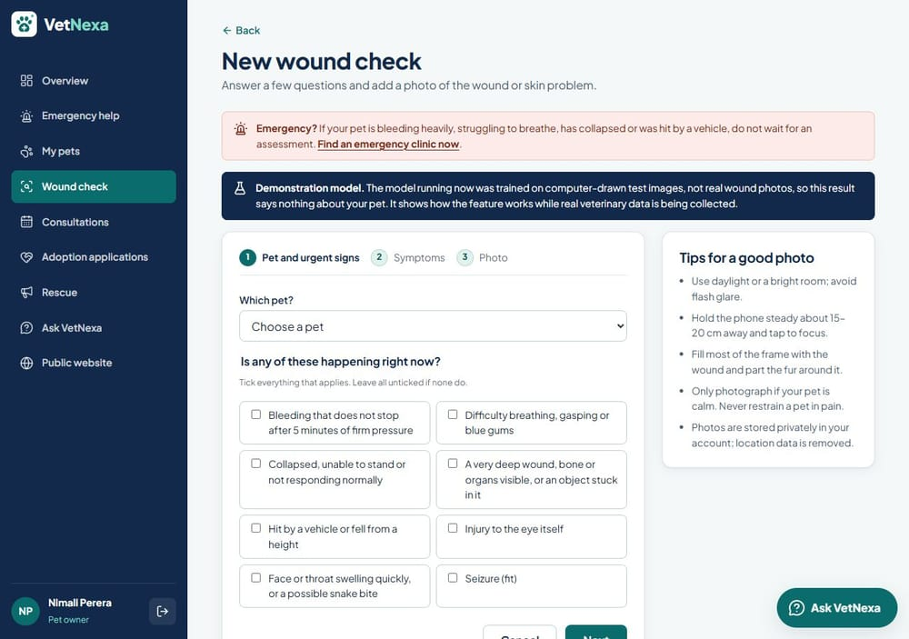

1. **Pet and danger signs.** Choose your pet and tick anything happening right now, such as
   heavy bleeding, breathing difficulty, collapse or a seizure. Any danger sign gives the
   result _Urgent veterinary attention_, whatever the photo shows.
2. **Symptoms.** Where the problem is, how long it has been there, the cause if known, what you
   see (swelling, smell, pus), appetite, energy and pain. "Not sure" is always fine.
3. **Photo.** Take a photo with your phone camera or upload one. Use daylight, hold the phone
   still 15–20 cm away and part the fur. Blurry, dark or very small photos are rejected with
   advice on taking a better one.

### Reading the result

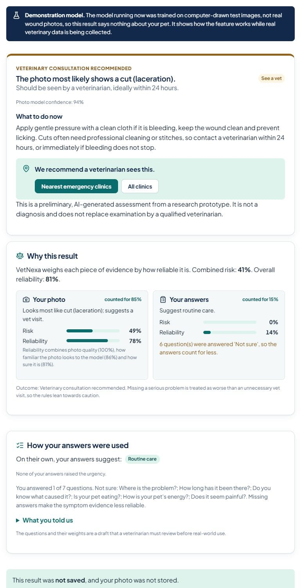

The result is one of four outcomes:

| Outcome                                 | Meaning                                                                                            |
| --------------------------------------- | -------------------------------------------------------------------------------------------------- |
| **Routine care / monitor**              | Care for it at home and watch it; see a vet if it gets worse.                                      |
| **Veterinary consultation recommended** | See a veterinarian, usually within 24 hours.                                                       |
| **Urgent veterinary attention**         | Go to a vet now. Nearest emergency clinics are shown straight away.                                |
| **Unable to assess safely**             | VetNexa could not judge it reliably (unclear photo, unfamiliar image, too few answers). See a vet. |

**Why this result** shows how much each piece of evidence counted. A clear photo and complete
answers count for more; an unclear or unfamiliar photo, or many "Not sure" answers, count for
less. When in doubt, VetNexa chooses the more cautious outcome.

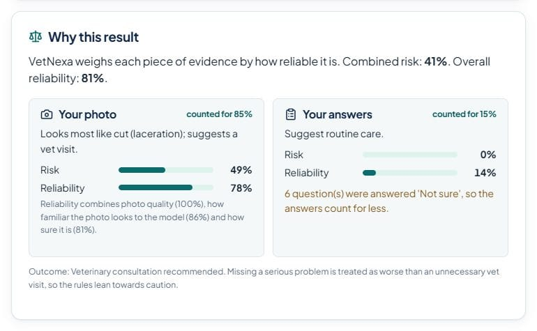

**Skin check (advisory).** Below the explanation, a second check may say which common skin
condition the photo looks most like: healthy skin, ringworm, mange, another fungal infection,
or inflamed or allergic skin. It does not change the outcome above and is not a diagnosis. When
it is not sure, or the photo looks unlike the skin photos it learned from, it says so instead
of guessing.

### Follow-up check-ins

Wounds can change quickly, so a saved result has a **Follow-up check** card. Choose when to
look again (tomorrow, in 2 or 3 days, or in a week). The reminder appears on your dashboard in
the web app and in the installed mobile app. When the time comes (or earlier, if something
changes), choose **Getting better**, **About the same** or **Getting worse**, add a note if you
like, and save. **Getting worse** always shows a clear "Please see a vet" message with links to
nearby clinics and booking. You can also check a new photo straight from the card.

Signed-in owners find past checks under **Wound check**, with notes and the full explanation.
A dark blue **Demonstration model** box means the current AI model was trained on drawings,
not real wound photos, so the result shows how the feature works but says nothing about your
pet.

## 5. Ask VetNexa, the pet-care assistant

Press **Ask VetNexa** in the bottom-right corner of any page, or open the full page from the
menu. Ask about vaccinations, parasites, feeding, symptoms, first aid or using VetNexa.

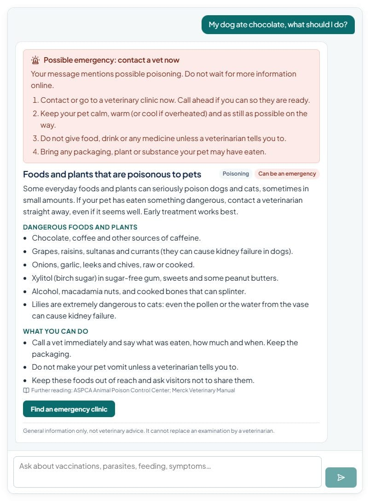

Answers come only from VetNexa's reviewed articles, with their sources. If a message sounds
like an emergency (poisoning, heavy bleeding, breathing problems, seizures), the assistant
tells you to contact a vet now and shows the emergency clinics. Signed-in users' conversations
are saved privately and can be deleted with **Clear conversation**.

## 6. Finding a clinic

**Find a clinic** lists clinics across Sri Lanka. Search by name or town, filter by city,
service, emergency care or **Open now**, and switch between **List** and **Map**.
**Near me** sorts by distance from where you are.

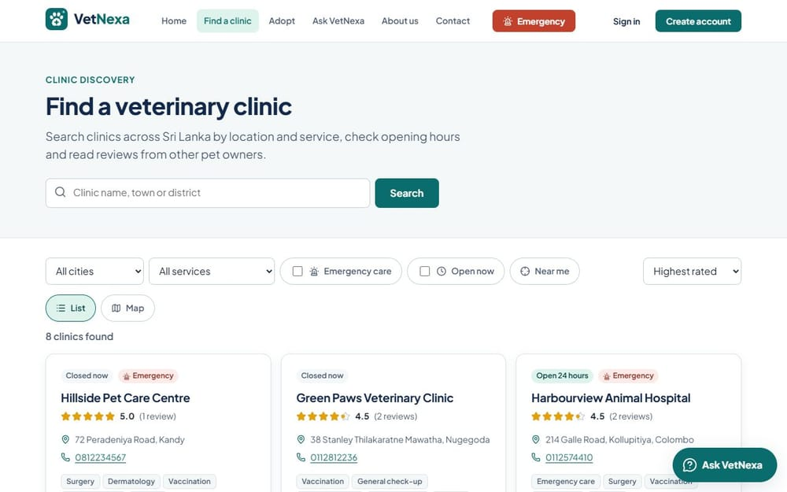

A clinic's page shows its address, opening hours, services, verified vets, ratings and
reviews, with **Call** and **Directions** buttons. Signed-in pet owners can write one review
per clinic and change or delete it later.

## 7. Rescue reports and adoption

### Reporting an animal in need

**Rescue → Report an animal** (or the emergency page without an account). Describe the
animal, how urgent it is, where it is, and mark the spot on the map. You can add a photo.

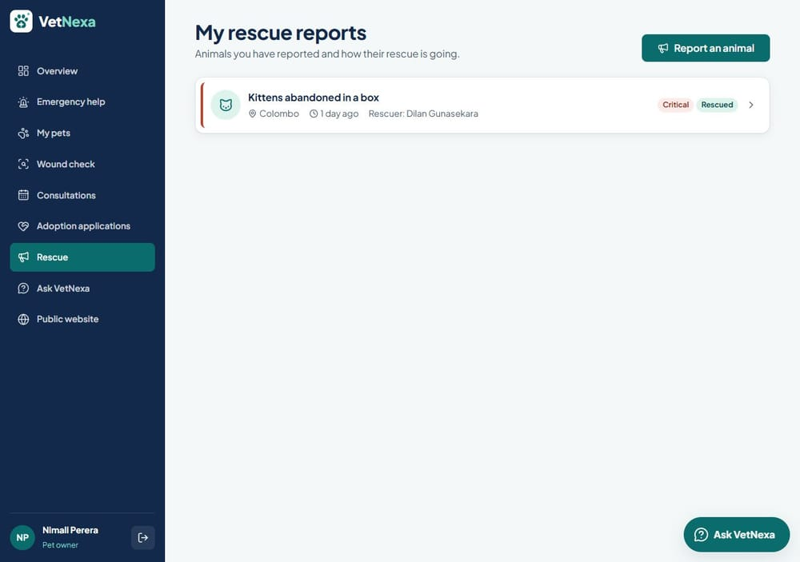

The exact spot is shown only to you, the rescuer who takes the report and administrators;
others see an area of about 1 km. Your phone number is shared only with registered rescuers.
You can follow the status: _Open_, _In progress_, _Rescued_ or _Closed_.

### Adopting

**Adopt** shows dogs and cats looking for a home. Filter by species, age and city, or show only
animals that are good with children. A
signed-in pet owner can apply once per animal with a short form about their home, and can
withdraw and apply again. Rescuers review applications and reply under
**Adoption applications**.

## 8. Veterinarians

After your licence is verified you can:

- **Consultations:** accept or decline new requests, see upcoming appointments and record the
  outcome when an appointment is completed.
- **Patients:** open a pet's health history while you have an active consultation with it, and
  add records that the owner cannot change.

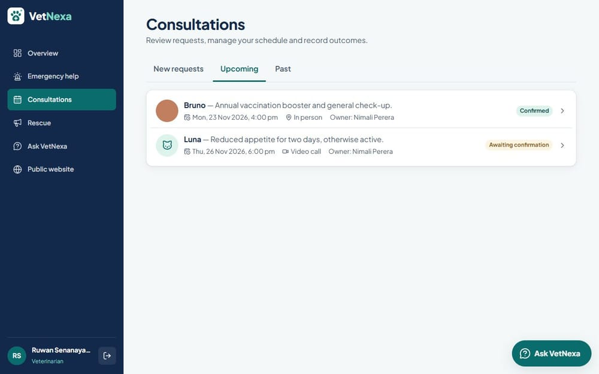

## 9. Rescuers

- **Rescue:** see open reports, **take one on** (only one rescuer at a time), call the
  reporter and mark it _Rescued_ or _Closed_.
- **Adoption listings:** **List an animal** with a photo and details, update its status and
  review applications. Approving one application marks the animal as adopted and kindly
  closes the others.

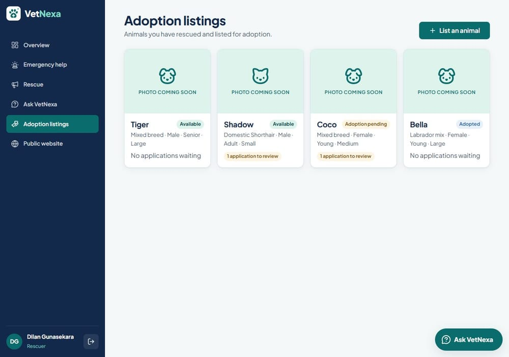

## 10. Administrators

**Administration** has six tabs:

| Tab              | Use                                                                 |
| ---------------- | ------------------------------------------------------------------- |
| Statistics       | What needs attention, platform numbers and weekly charts            |
| Users            | Search users, suspend or reactivate accounts (takes effect at once) |
| Vet verification | Check licence numbers and approve or reject veterinarians           |
| Clinics          | Add and edit clinics, opening hours and services; hide a clinic     |
| Reviews          | Hide unsuitable reviews (the clinic's rating updates)               |
| Messages         | Read and close messages from the contact form                       |

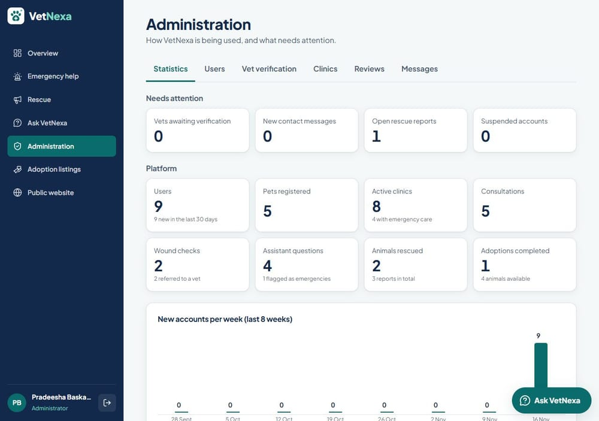

Administrators cannot suspend themselves or other administrators.

## 11. Installing VetNexa on your phone

- **Android (Chrome or Edge):** press **Install app** on the card at the bottom of the page.
- **iPhone or iPad (Safari):** press **Share**, then **Add to Home Screen**.
- **Computer (Chrome or Edge):** use the install icon in the address bar.

Press and hold the VetNexa icon for shortcuts to **Emergency help**, **Find a clinic** and a
**New wound check**. If you close the install card with ✕, it will not appear again on that
browser.

## 12. Privacy and safety

- Health records, wound photos and conversations are visible only to you, and to a vet while
  you have a consultation with them. Another user who changes a link only sees "not found".
- Photos are re-saved without their location data before they are stored.
- Wound checks without an account are not stored at all.
- Nothing private is kept on your phone for offline use: only the public clinic list and, until
  it is sent, a rescue report you wrote yourself.
- The AI results are cautious: missing a serious problem is treated as worse than an
  unnecessary vet visit.

## 13. Questions and answers

**The page says "This page could not load".** VetNexa may have just been updated, or the
connection dropped. Press **Try again**. In an emergency press **Emergency help**, which also
works offline.

**My photo was rejected.** Take it again in daylight, closer and steadier, without flash glare.

**Why did I get "Unable to assess safely"?** The photo was unclear or did not look like a wound
or skin, and there were not enough answers to decide safely. Please see a veterinarian.

**I am a vet but cannot see patients.** An administrator has not verified your licence yet.

**I forgot my password.** Password reset by email is not available in this version. Use
**Forgot your password? Contact support** on the sign-in page and an administrator will help.

**Contact:** Pradeesha Baskaran, 0785503592, or the **Contact** page in VetNexa.
